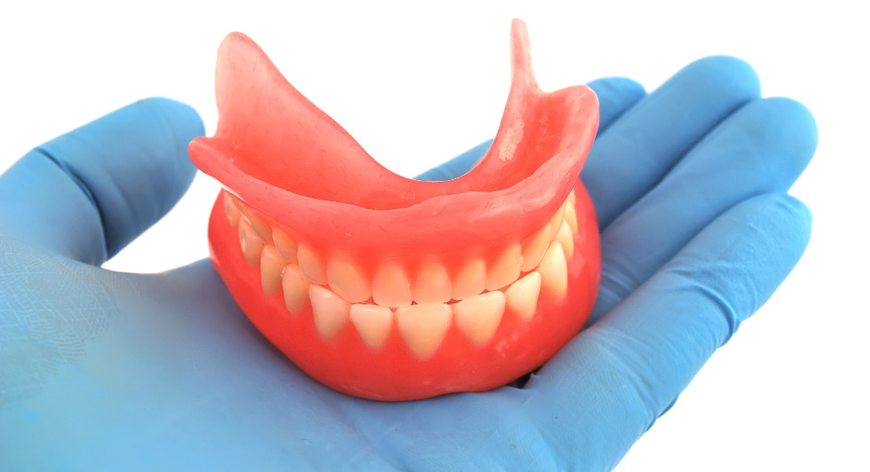
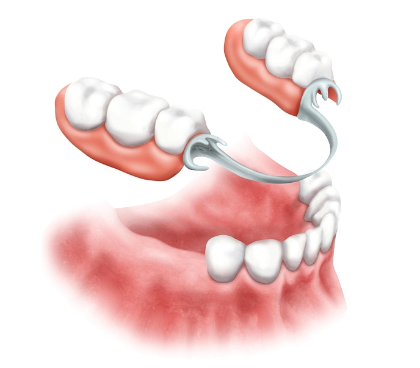
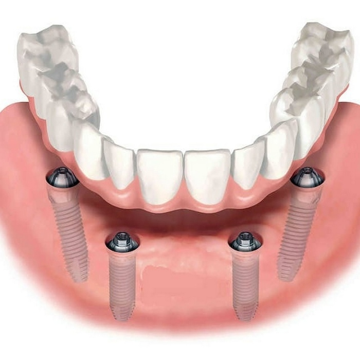

## Коронки и виниры

| Конструкция | Стоимость |
|---|---:|
| Коронка из PMMA (временная коронка) | от **6 800** рублей |
| Коронка из металлокомпозита | от **14 500** рублей |
| Коронка из металлокерамики | от **18 900** рублей |
| Коронка из керамики | от **23 300** рублей |
| Винир из оксида циркония | от **24 400** рублей |
| Винир из керамики | от **22 000** рублей |

## Съёмное протезирование

- **Съёмный протез (обычный, на присосках)** — от **35 000** рублей за одну челюсть.

Зубной протез на присосках — съёмная ортопедическая система, опирающаяся на десны, альвеолярный отросток и небо. Удерживается во рту такая конструкция за счёт **вакуумного эффекта**, никаких дополнительных присосок у протеза нет — **он сам является присоской.** При установке воздух между десной и основанием ортопедической системы вытесняется, создавая отрицательное давление, что герметизирует конструкцию, сохраняя ее стабильную фиксацию. Протез челюсти на присосках **состоит из** основания, имитирующего десну, на котором закреплены искусственные… <!-- TODO: текст обрезан на скриншоте -->

- **Бюгельный протез** — от **48 000** рублей за одну челюсть.

Бюгельный протез — это съемная конструкция, которая устанавливается **при отсутствии зубов с двух сторон** зубного ряда. Такой протез одинаково хорошо подходит для верхней и нижней челюсти. Его **основу составляет** металлическая сетчатая дуга или по-иному — **бюгель**, на которой закрепляется пластиковый **десневой базис**. Искусственные зубные коронки выполняются из керамики и крепятся непосредственно на бюгельный каркас. Наличие каркасной дуги позволяет равномерно распределить жевательную нагрузку, способствуя тем самым лучшей сохранности опорных зубов.

## Несъёмное протезирование

- **На 2-х имплантах All-on-2** — от **230 000** рублей за одну челюсть.
- **На 4-х имплантах All-on-4**.
- **Имплантация Riellens «под ключ»** с установкой временной конструкции во сне — всего за **260 000** рублей (одна челюсть). Что включено:
  - сама операция по методике All-on-4 (импланты Riellens);
  - процедура в наркозе — без боли, страха и стресса;
  - адаптационный (временный) протез.

  Количество мест по этой цене ограничено.
- **На 6-ти имплантах All-on-6** — от **600 000** рублей за одну челюсть.

Все технологии совмещают в себе **два способа** восстановления зубов — имплантация и протезирование. В основе методов лежит использование **имплантов,** которые вживляют в костную ткань. Затем на них надевают **протезы.**

Это позволяет **полностью восстановить** зубной ряд.

